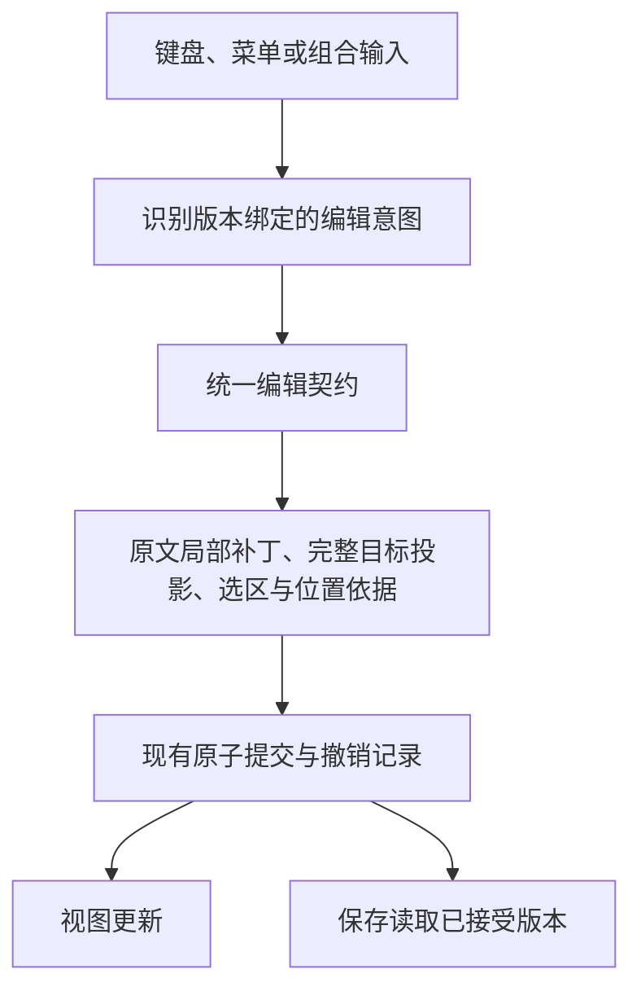

# 文末空段落编辑契约与编辑器设计

## 当前判断

209有可重复执行的证据，支持“存在设计契约缺口”，不支持把所有历史bug归因于同一个原因。Markdown原文仍是唯一内容权威；问题是派生投影和位置依据生命周期没有始终随一次编辑完整更新。标题切片通过，不代表列表或普通空段落旅程通过。

精确反例：从空列表连续Enter三次，末尾Backspace生成删除6..8的结构步骤；完整目标只减少一个空段落，未动列表。原文插入锚点在PM3/7/9，PM6是段落包装边界，不是文本锚点。通用文本补丁规划拿它查文本映射，事务被拒绝，未解决意图随后阻断保存/关闭。重新构建位置context完全相同，排除单纯缓存过期。原位置信息映射到被删包装边界后残留，是另一项同类生命周期缺口。

## 一般路线与取舍

| 路线 | 内容权威 | 主要成本 |
|---|---|---|
| 源码编辑加预览 | 原始文本 | 编辑保真直接，可视交互需派生 |
| 富文本结构编辑 | 结构树 | 编辑自然，导出Markdown需额外保留原写法 |
| 即时渲染Markdown | 原文及有依据的可编辑投影 | 需同时处理语法、空白、位置、组合输入与历史 |

Inkora采用第三种。方向可继续，但语义解析树不是保真文本，也不是所有作者插入点的清单。CommonMark渲染会忽略许多空白行；作者仍必须能编辑它们。ProseMirror把文档、完整选区等置于状态，以事务转换；CodeMirror也使用不可变状态和事务，视图由状态驱动。Inkora增加的原文/投影边界应遵守同样完整的提交要求，而非DOM改完后再猜原文。

## 本轮落实的边界

- 创建文末空段落、删除一个空段落共用模块operation；键盘与Native适配器不各自重新解释意图。
- 源码变更保留关闭语法、原有space/tab、BOM及EOL；只补入或删除本次已证明的一对EOL，不全篇序列化。
- 同一接受结果绑定目标doc与完整Selection，发布新插入点；仅退休确实被同事务删掉的空段落旧锚点。
- 不明编辑保留当前原文、选区与未解决意图，不能通过关闭守卫或无条件parser相等来放行。
- 以连续旅程验证：创建列表、退出、连续回车、逐行删除、继续输入、Undo/Redo、实际保存、关闭及重开字节。真实系统交互与合成测试分开记录。

本轮范围限于文末paragraph及其相邻paragraph/heading/普通或有序列表；没有重写全部编辑内核。尾部引用定义、保护内容和初始化tab等已记录继承边界仍需后续反馈回路；不能用此局部通过宣告日常编辑整体稳定。下一步应先把剩余失败旅程冻结，再按同一原文/投影契约逐类迁移，停止以补丁数量或测试总数替代体验证据。

## 官方资料

- [ProseMirror Guide：状态、事务、选区与变换](https://prosemirror.net/docs/guide/)
- [CodeMirror System Guide：不可变状态与事务](https://codemirror.net/docs/guide/)
- [CommonMark 0.31.2：空白行](https://spec.commonmark.org/0.31.2/#blank-lines)
