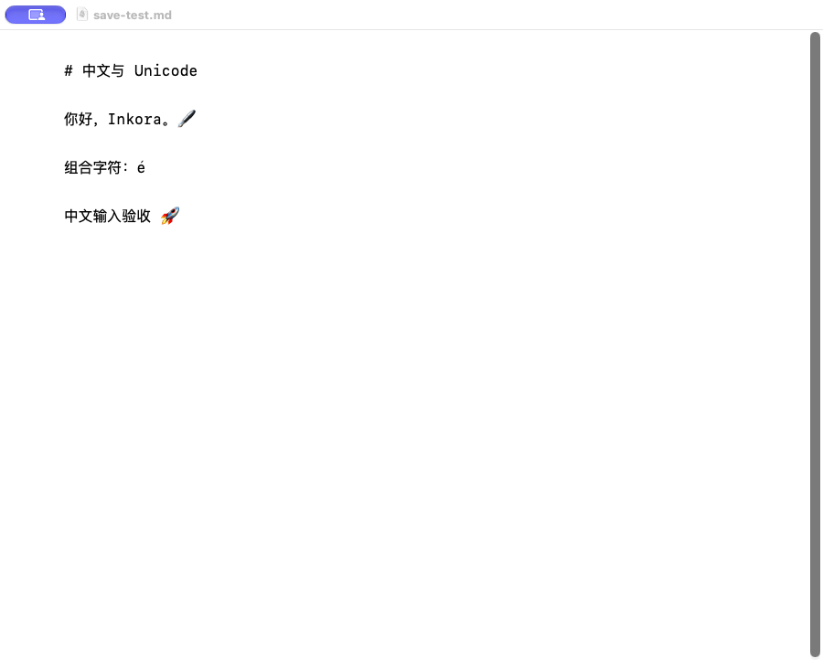

# INK-001 验收记录

- 日期：2026-11-06
- 环境：macOS 27.2、Xcode 27.2（27B52）、Apple Silicon

## 自动化命令

- `make setup`：通过；Homebrew 依赖已满足，pnpm frozen install、编辑器构建与 XcodeGen 生成成功。
- `make build`：通过；Debug App 构建成功。
- `make test`：通过；Vitest 与 XCTest 全部通过。
- `make lint`：通过；`swift-format --strict` 与 `tsc --noEmit` 无错误。
- `codesign --verify --deep --strict --verbose=2 <Inkora.app>`：通过。

`codesign -d --entitlements - <Inkora.app>` 的干净 Debug 构建输出摘要：

```text
[Key] com.apple.security.app-sandbox
[Value] true
[Key] com.apple.security.files.user-selected.read-write
[Value] true
[Key] com.apple.security.get-task-allow
[Value] true
[Key] com.apple.security.network.client
[Value] true
```

## 运行验收

1. 将 `tests/fixtures/crlf.md` 复制到临时目录，用 Inkora 打开后不修改并保存。
2. 执行 `cmp -s tests/fixtures/crlf.md <临时目录>/crlf.md; echo $?`，输出 `0`。
3. 打开 UTF-8 中文 fixture，加入 `中文输入验收 🚀` 后保存；磁盘文件包含该文本。
4. App 内编辑器 URL 为 `inkora-editor://app/index.html`；HTTP/HTTPS 导航不在白名单内，CSP 设置
   `connect-src 'none'`。
5. 签名 entitlement 包含 App Sandbox、用户选择文件读写和 WKWebView 在当前系统所需的
   `network.client`；平台例外及离线约束见 ADR-0003。

## 截图


