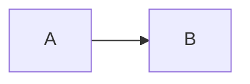

# 性能混排

正文包含中文、English、é 和 👩‍💻，以及 **粗体**、*强调*、~~删除~~、`a < b`。

[行内链接](./local.md "标题") 与 [参考链接][ref]。

- [ ] 待办事项
- [x] 已完成事项

| 标题 | 值 |
| :--- | ---: |
| 管道\|字面 | 123 |

> 引用中的正文。

```typescript
const value = "离线代码";
```

$$
x + y = z
$$



正文脚注[^note]与最后一个段落。

[^note]: 脚注原文保留。

[ref]: ./reference.md "引用定义"
